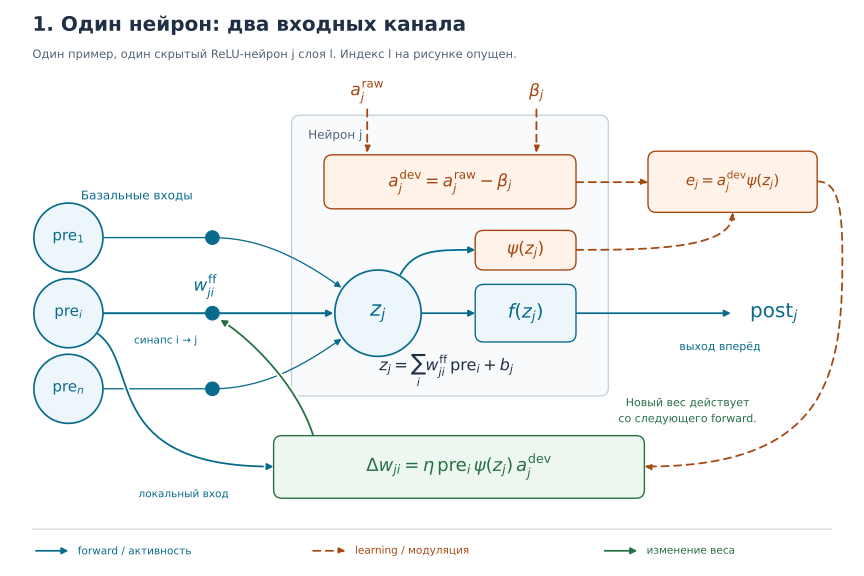
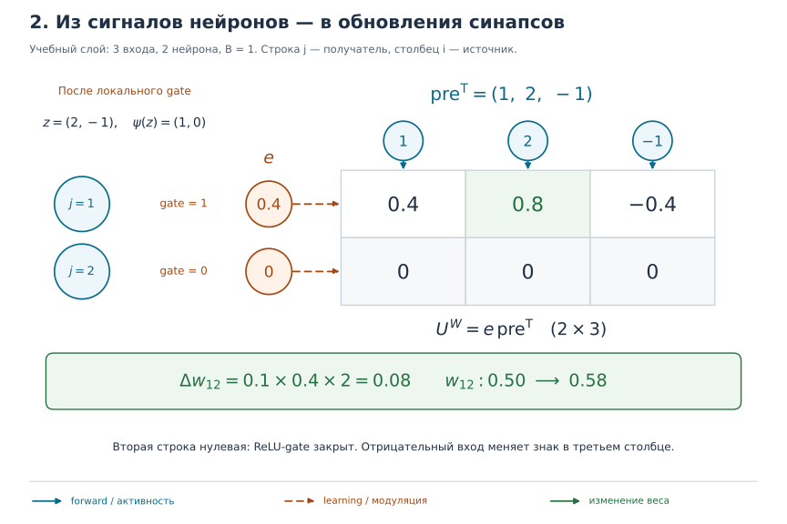
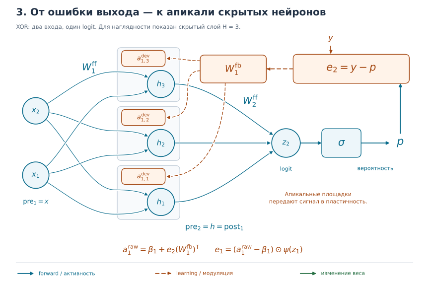
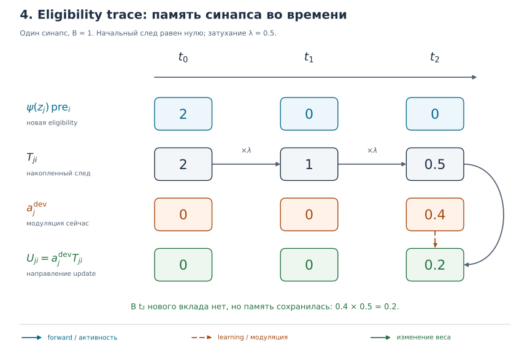

# Сессия 1.0 — формулы локального правила

Этот документ — исполняемый математический контракт для блока 1. Код
`ThreeFactorLayer` и тесты должны сверяться с ним, а не восстанавливать смысл из
нескольких описательных разделов research plan.

Документ можно читать от рисунков к формулам: сначала проследить стрелки у
одного нейрона, затем разобрать численный пример синапса, пройти по целой сети
и только потом перейти к памяти во времени. Каждая иллюстрация стоит рядом с
соответствующими уравнениями.

На всех рисунках **синие сплошные стрелки** обозначают передачу активности,
**оранжевые пунктирные** — обучающий сигнал, **зелёные** — изменение веса.
Серые рамки объединяют части одного нейрона. Это схемы вычислений нашего
прототипа: расположение отсеков показывает разделение функций, а не точную
анатомию биологического нейрона.

У каждой связи своя точка входа в нейрон, чтобы наконечники не сливались.
Светлый зазор на пересечении линий означает, что связи не соединены.

## Граница первой реализации

Сессии 1.1–1.7 реализуют мгновенный режим (`feedback_delay = 0`) без
долговременного eligibility trace. Сначала проверяется точная доставка
$W_l^{\mathrm{fb}}=(W_{l+1}^{\mathrm{ff}})^{\mathsf T}$, затем фиксированная
случайная доставка. Temporal trace
добавляется отдельно в сессии 1.8 и не должен усложнять проверку базовой
механики.

Для XOR используются float32, полный батч из четырёх примеров и сеть
$2 \to H \to 1$. Скрытый слой имеет ReLU, выходной слой возвращает logit без
активации; вероятность равна $\sigma(\mathrm{logit})$. Обновления выполняются вручную
под `torch.no_grad()`, без `torch.optim`.

## Сначала один нейрон



*Рисунок 1. Следите сначала за синим путём слева направо, затем за оранжевым
сверху вниз и, наконец, за зелёной стрелкой к весу.*

Кружки слева — выходы предыдущих нейронов. Для выбранного нейрона они
называются $\mathrm{pre}_i$: «активность **до** нашей связи». Маленькая точка
на стрелке — синапс, его вес $w_{ji}^{\mathrm{ff}}$ определяет вклад этого
входа. Нейрон складывает взвешенные входы и bias $b_j$, получая $z_j$.
Функция $f$ превращает эту сумму в $\mathrm{post}_j$: активность **после**
нейрона, которая идёт дальше по сети.

У верхнего отсека другая роль. Сюда приходит $a_j^{\mathrm{raw}}$; из него
вычитается фоновый уровень $\beta_j$, и остаётся знаковое отклонение
$a_j^{\mathrm{dev}}$. Оно вместе с локальным gate $\psi(z_j)$ образует
сигнал $e_j$. Внизу этот сигнал встречается с активностью входа
$\mathrm{pre}_i$ и задаёт изменение **конкретной связи** $i\to j$.
Уже вычисленный $\mathrm{post}_j$ остаётся прежним; новый вес будет
использован при следующем forward.

У $f$ и $\psi$ общий аргумент $z$, но разные задачи. Для ReLU функция
$f(z)=\max(0,z)$ определяет величину выхода, а $\psi(z)=\mathbf{1}[z>0]$
служит переключателем пластичности: при $z>0$ равна 1, иначе 0.
Например, при $z=2$ выход равен 2, а gate равен 1. Поэтому в обновлении
нельзя незаметно заменить $\psi(z)$ на $\mathrm{post}$.

Как читать индексы: $l$ — слой, $i$ — вход, $j$ — принимающий нейрон.
Элемент $w_{ji}^{\mathrm{ff}}=W_l^{\mathrm{ff}}[j,i]$ лежит в строке $j$
и столбце $i$ матрицы весов. На рисунках одного слоя индекс $l$ опущен.
Метки $\mathrm{ff}$, $\mathrm{fb}$, $\mathrm{raw}$ и $\mathrm{dev}$ —
названия вида величины, **не степени**. Величина $\eta$ — скорость обучения,
обозначенная в коде как `lr`.

## Обозначения и размерности

Слой $l$ отображает $n_{l-1}$ входов в $n_l$ нейронов. Батч расположен в
первой оси.

| Величина | Размерность | Смысл |
|---|---:|---|
| $\mathrm{pre}_l$ | $B \times n_{l-1}$ | базальный вход слоя |
| $W_l^{\mathrm{ff}}$ | $n_l \times n_{l-1}$ | прямые веса |
| $b_l$ | $n_l$ | bias |
| $z_l$ | $B \times n_l$ | предактивация |
| $\mathrm{post}_l$ | $B \times n_l$ | forward-выход |
| $a_l^{\mathrm{raw}}$ | $B \times n_l$ | сырой апикальный сигнал |
| $\beta_l$ | broadcastable к $B \times n_l$ | baseline |
| $a_l^{\mathrm{dev}}$ | $B \times n_l$ | отклонение $a_l^{\mathrm{raw}}-\beta_l$ |
| $\psi_l(z_l)$ | $B \times n_l$ | локальный gate пластичности |
| $e_l$ | $B \times n_l$ | локальный descent-сигнал |
| $W_l^{\mathrm{fb}}$ | $n_l \times n_{l+1}$ | доставка сигнала из слоя $l+1$ в $l$ |
| $U_l^W$ | $n_l \times n_{l-1}$ | направление изменения $W_l^{\mathrm{ff}}$ |
| $U_l^b$ | $n_l$ | направление изменения $b_l$ |

Индексы весов следуют PyTorch: $W_l^{\mathrm{ff}}[j,i]$ соединяет вход $i$ с
нейроном $j$. Поэтому forward в batch-нотации использует транспонирование
матрицы весов.

## Forward-канал

Для каждого слоя:

$$
\begin{aligned}
z_l &= \mathrm{pre}_l (W_l^{\mathrm{ff}})^{\mathsf T} + b_l, \\
\mathrm{post}_l &= f_l(z_l).
\end{aligned}
$$

Для скрытого ReLU-слоя:

$$
f_l(z)=\max(0,z),
\qquad
\psi_l(z)=\mathbf{1}[z>0].
$$

Для выходного XOR-logit:

$$
f_L(z)=z,
\qquad
\psi_L(z)=1.
$$

$\mathrm{pre}_l$, $z_l$ и $\mathrm{post}_l$ сохраняются как detached-снимки
текущего атомарного шага. $a_l^{\mathrm{raw}}$, $a_l^{\mathrm{dev}}$ и $e_l$
не участвуют в этих уравнениях. Вызов learning-канала не имеет права менять уже
вычисленный $\mathrm{post}_l$.

## Learning-канал и знак обновления

Для начала рассмотрим одну связь и один пример, то есть $B=1$.
Три множителя на рисунке 1 читаются буквально:

$$
\Delta w_{ji}
=\eta\,
\underbrace{\mathrm{pre}_i}_{\text{активность входа}}\,
\underbrace{\psi(z_j)}_{\text{локальный gate}}\,
\underbrace{(a_j^{\mathrm{raw}}-\beta_j)}_{\text{обучающее отклонение}}.
$$

Здесь $\Delta w_{ji}$ — прибавка к весу. Сигнал $e_j$ объединяет последние
два множителя; он общий для входящих связей одного нейрона, а
$\mathrm{pre}_i$ различается от связи к связи.

В проекте $e_l$ — **descent-сигнал**, то есть отрицательная производная
per-example loss $\ell_b$ по $z_l$ в режиме точной верификации:

$$
e_l^{(b)} := -\frac{\partial \ell_b}{\partial z_l^{(b)}}.
$$

Это соглашение необходимо из-за ручного обновления со знаком $+$:

$$
\begin{aligned}
a_l^{\mathrm{dev}} &= a_l^{\mathrm{raw}}-\beta_l, \\
e_l &= a_l^{\mathrm{dev}}\odot\psi_l(z_l), \\
U_l^W &= \frac{1}{B}\sum_{b=1}^{B}
    e_l^{(b)}(\mathrm{pre}_l^{(b)})^{\mathsf T}, \\
U_l^b &= \frac{1}{B}\sum_{b=1}^{B} e_l^{(b)}, \\
W_l^{\mathrm{ff}} &\leftarrow W_l^{\mathrm{ff}}+\eta_l U_l^W, \\
b_l &\leftarrow b_l+\eta_l U_l^b.
\end{aligned}
$$

Здесь $\odot$ — поэлементное умножение, а в сумме векторы считаются
столбцами. Если в тесте используется обычный autograd-градиент средней ошибки,
то сравнивать нужно

$$
U_l^W=-\nabla_{W_l^{\mathrm{ff}}}
\left(\frac{1}{B}\sum_{b=1}^{B}\ell_b\right),
\qquad
U_l^b=-\nabla_{b_l}
\left(\frac{1}{B}\sum_{b=1}^{B}\ell_b\right).
$$

Называть $e_l$ обычным gradient-сигналом
$\delta_l=\partial\mathcal L/\partial z_l$ нельзя без явного минуса. Три
локальных фактора здесь — $\mathrm{pre}_l$, post-зависимый gate $\psi_l(z_l)$
и сегрегированное апикальное отклонение $a_l^{\mathrm{dev}}$.

### Численный пример: одна связь, затем вся матрица



*Рисунок 2. Каждая клетка — произведение сигнала своего нейрона на активность
своего входа. Это смысл внешнего произведения, обозначаемого $\otimes$.*

Это отдельный учебный слой с тремя входами и двумя нейронами, а не
архитектура XOR. Векторы одного примера здесь записаны столбцами;
батч из таблицы размерностей состоит из таких примеров, уложенных строками.
Возьмём:

$$
\begin{aligned}
\mathrm{pre}&=(1,\ 2,\ -1)^{\mathsf T},&
z&=(2,\ -1)^{\mathsf T},\\
a^{\mathrm{raw}}&=(0.7,\ 0)^{\mathsf T},&
\beta&=(0.3,\ 0.3)^{\mathsf T},\\
a^{\mathrm{dev}}&=(0.4,\ -0.3)^{\mathsf T},&
\psi(z)&=(1,\ 0)^{\mathsf T},\\
e&=(0.4,\ 0)^{\mathsf T},&
\eta&=0.1.
\end{aligned}
$$

Для выделенной связи от входа $i=2$ к нейрону $j=1$:

$$
\begin{aligned}
U^W_{12}&=e_1\,\mathrm{pre}_2=0.4\cdot2=0.8,\\
\Delta w_{12}&=\eta U^W_{12}=0.1\cdot0.8=0.08,\\
w_{12}^{\mathrm{new}}&=w_{12}^{\mathrm{old}}+\Delta w_{12}
=0.50+0.08=0.58.
\end{aligned}
$$

Матрица получается, когда мы делаем то же самое для всех связей:

$$
U^W=
\begin{pmatrix}0.4\\0\end{pmatrix}
\begin{pmatrix}1&2&-1\end{pmatrix}
=
\begin{pmatrix}
0.4&0.8&-0.4\\
0&0&0
\end{pmatrix}.
$$

Вторая строка нулевая, хотя апикальное отклонение второго нейрона ненулевое:
его gate закрыт. В третьем столбце первой строки знак отрицательный из-за
отрицательного входа. Поэтому положительное $e_j$ само по себе не означает
увеличшения всех входящих весов.

Для батча каждый пример сначала даёт **свою матрицу произведений**, после
чего матрицы усредняются. Например, при двух примерах
$U^W=\tfrac12(U^{W,(1)}+U^{W,(2)})$. Произведение отдельно усреднённых $e$ и
$\mathrm{pre}$ в общем случае даёт другой результат. Направление $U^W$ ещё
не содержит скорость обучения: фактическая прибавка равна $\Delta W=\eta U^W$.

**Самопроверка по рисунку.** Как изменится выделенный вес, если
$a_1^{\mathrm{raw}}=\beta_1$? А если поменять знак
$a_1^{\mathrm{dev}}$, сохранив вход и gate? Сначала предскажите движение
веса по стрелкам, затем подставьте числа.

### Откуда берётся сигнал выходного нейрона

Для `BCEWithLogitsLoss` на выходе XOR:

$$
\begin{aligned}
p &= \sigma(z_L), \\
a_L^{\mathrm{raw}} &= \beta_L+y-p, \\
a_L^{\mathrm{dev}} &= y-p, \\
e_L &= y-p.
\end{aligned}
$$

То есть выходной $e_L$ уже является отрицательной производной loss по logit.

В формулах $y$ — правильный ответ, а $p$ — предсказанная вероятность.
Если $y=1$, а $p=0.2$, сигнал $e_L=0.8$ направлен на повышение logit.
При $y=0$ и том же $p$ получается $e_L=-0.2$. Это объясняет знак $+$ в
обновлении: нужное направление уже закодировано знаком $e_L$.

## Доставка апикального сигнала



*Рисунок 3. У каждого скрытого нейрона есть синий выход и отдельная
оранжевая апикальная площадка в общей серой рамке. Внутреннее превращение
апикального отклонения в обновление связи раскрыто на рисунке 1.*

Пройдите по синему пути: вход $x$ превращается в скрытые активности
$h=\mathrm{post}_1$, затем в logit $z_2$ и вероятность $p=\sigma(z_2)$.
Сам выходной слой возвращает logit; sigmoid здесь показана для вычисления
вероятности и обучающего сигнала.

Теперь идите по оранжевому пути справа налево. Источник сравнивает $p$ с
меткой $y$ и выдаёт $e_2$. Матрица $W_1^{\mathrm{fb}}$ доставляет свою
взвешенную версию этого сигнала каждому скрытому нейрону. Для одного примера
и скалярного выхода это особенно просто:

$$
a_{1,j}^{\mathrm{dev}}=W_1^{\mathrm{fb}}[j,1]\,e_2.
$$

Таким образом, один выходной сигнал может дать разным скрытым нейронам
разные знаки и величины модуляции. На площадках рисунка уже показано
отклонение после вычитания baseline. Синие связи хранят
$W^{\mathrm{ff}}$, оранжевые — $W^{\mathrm{fb}}$; это разные матрицы.

Для соседних слоёв мгновенного режима:

$$
\begin{aligned}
a_l^{\mathrm{raw}} &= \beta_l+e_{l+1}(W_l^{\mathrm{fb}})^{\mathsf T}, \\
a_l^{\mathrm{dev}} &= e_{l+1}(W_l^{\mathrm{fb}})^{\mathsf T}, \\
e_l &= a_l^{\mathrm{dev}}\odot\psi_l(z_l).
\end{aligned}
$$

В точном режиме:

$$
W_l^{\mathrm{fb}}=(W_{l+1}^{\mathrm{ff}})^{\mathsf T}.
$$

Это связь, обновляемая из pre-update snapshot на каждом шаге, а не однажды
скопированная и затем замороженная матрица. Тогда
$e_l^{(b)}=-\partial\ell_b/\partial z_l^{(b)}$. Матрица
$W_l^{\mathrm{fb}}$ и все $e_l$
вычисляются по одному снимку параметров **до** обновления. Сначала строятся
сигналы и направления обновления для всех слоёв, и только затем одновременно
применяются новые веса. Использование уже обновлённого верхнего слоя меняет
алгоритм и ломает сравнение с backprop.

В случайном режиме $W_l^{\mathrm{fb}}$ имеет ту же форму, инициализируется с нулевым
средним, фиксируется и не является параметром forward-канала.

На рисунке один скрытый слой, поэтому соседний слой одновременно является
выходным. При большей глубине эта рекурсивная доставка относится к feedback
alignment (FA); direct feedback alignment (DFA) потребовала бы прямых
обратных стрелок от выхода к каждому скрытому слою.

## Eligibility trace в сессии 1.8



*Рисунок 4. След хранит локальную eligibility, а поздний апикальный сигнал
использует сохранившееся значение. Это отдельный temporal-режим с $B=1$.*

Читайте рисунок по столбцам времени. В $t_0$ связь получает локальный вклад
$\psi(z_j)\mathrm{pre}_i=2$, но модуляции ещё нет, поэтому вес не меняется.
В следующие два такта новых вкладов нет; при $\lambda=0.5$ память затухает:
$2\to1\to0.5$. В $t_2$ приходит $a_j^{\mathrm{dev}}=0.4$ и получается
$U^W_{ji}=0.4\cdot0.5=0.2$. При $\eta=0.1$ это дало бы
$\Delta w_{ji}=0.02$. Здесь $\lambda$ соответствует параметру `decay`.

Gate уже участвовал в **записи** eligibility. В этом temporal-правиле при
позднем чтении следа мы не умножаем его ещё раз на текущий gate. При
$\lambda=0$ к моменту $t_2$ след исчез бы и поздний сигнал не дал бы
обновления в данном примере.

Слово trace не должно обозначать одновременно
$\mathrm{post}\otimes\mathrm{pre}$ и выражение, эквивалентное
$e\otimes\mathrm{pre}$: при $e=a_{\mathrm{dev}}\odot\psi(z)$ первая формула
добавляет лишний множитель $\mathrm{post}$ и эквивалентности нет.

Канонический trace для продолжения проверяемого правила хранит локальную
eligibility, а апикальный сигнал остаётся третьим фактором. Для одного элемента
потока:

$$
\begin{aligned}
T_l^W(t) &= \lambda T_l^W(t-1)
    +\psi_l(z_l(t))\otimes\mathrm{pre}_l(t), \\
T_l^b(t) &= \lambda T_l^b(t-1)+\psi_l(z_l(t)), \\
U_l^W(t) &= \operatorname{diag}\!\left(a_l^{\mathrm{dev}}(t)\right)T_l^W(t), \\
U_l^b(t) &= a_l^{\mathrm{dev}}(t)\odot T_l^b(t).
\end{aligned}
$$

При $\lambda=0$ это в точности сводится к мгновенному обновлению выше. Для
батча с разными апикальными сигналами нужен независимый trace на пример
$B \times n_l \times n_{l-1}$ с усреднением **после** умножения на
$a_l^{\mathrm{dev}}$.
Усреднять eligibility по батчу до модуляции допустимо только при общем для всего
батча апикальном сигнале. В первой temporal-реализации безопаснее использовать
поток с $B=1$.

Необходимо различать три механизма:

- eligibility trace блока 1, определённый выше;
- Hebbian co-activation accumulator
  $\lambda T+\mathrm{post}\otimes\mathrm{pre}$ как отдельную
  абляцию;
- trace постсинаптической активности Фёльдьяка из блока 4, используемый в
  $T_l^{\mathrm{post}}(t)\otimes\mathrm{pre}_l(t)$ для обучения
  инвариантности.

Последние два правила не обязаны совпадать с backprop при
$W_l^{\mathrm{fb}}=(W_{l+1}^{\mathrm{ff}})^{\mathsf T}$ и не должны подменять
центральный тест корректности. Они могут
переиспользовать хранение состояния и decay, но не один безымянный update
kernel.

## Последовательность одного атомарного шага

1. Forward выполняется снизу вверх без learning-сигнала:

   $$
   \begin{aligned}
   \mathrm{pre}_1 &= x, \\
   z_l &= \mathrm{pre}_l(W_l^{\mathrm{ff}})^{\mathsf T}+b_l, \\
   \mathrm{post}_l &= f_l(z_l), \\
   \mathrm{pre}_{l+1} &= \mathrm{post}_l
   \quad (l=1,\ldots,L-1).
   \end{aligned}
   $$

2. Подключаемый source формирует сырой output-сигнал:

   $$
   a_L^{\mathrm{raw}}
   =\beta_L+s_{\mathrm{out}}(\mathrm{post}_L,y),
   $$

   где $s_{\mathrm{out}}$ возвращает descent-сигнал задачи.

3. Learning-канал вычисляется сверху вниз, для
   $l=L,L-1,\ldots,1$, по одному снимку старых весов:

   $$
   \begin{aligned}
   a_l^{\mathrm{dev}} &= a_l^{\mathrm{raw}}-\beta_l, \\
   e_l &= a_l^{\mathrm{dev}}\odot\psi_l(z_l), \\
   U_l^W &= \frac{1}{B}\sum_{b=1}^{B}
       e_l^{(b)}(\mathrm{pre}_l^{(b)})^{\mathsf T}, \\
   U_l^b &= \frac{1}{B}\sum_{b=1}^{B}e_l^{(b)}, \\
   a_{l-1}^{\mathrm{raw}} &= \beta_{l-1}
       +e_l(W_{l-1}^{\mathrm{fb}})^{\mathsf T}
       \quad (l>1).
   \end{aligned}
   $$

4. Только после вычисления всех направлений параметры всех слоёв меняются
   одновременно под `torch.no_grad()`:

   $$
   \begin{aligned}
   W_l^{\mathrm{ff}} &\leftarrow W_l^{\mathrm{ff}}+\eta_l U_l^W, \\
   b_l &\leftarrow b_l+\eta_l U_l^b,
   \qquad l=1,\ldots,L.
   \end{aligned}
   $$

Источник output-сигнала является отдельным объектом. Переключение между
supervised, predictive и reward-режимами не добавляет `if` внутрь слоя.

## Инварианты и будущие тесты

1. `forward(pre)` численно совпадает с `nn.Linear + activation` при одинаковых
   $W_l^{\mathrm{ff}}$ и $b_l$; сохранённые $\mathrm{pre}_l$, $z_l$ и
   $\mathrm{post}_l$ detached и имеют ожидаемые формы.
2. Изменение $a_l^{\mathrm{raw}}$ при фиксированных параметрах и
   $\mathrm{pre}_l$ не меняет forward.
3. При $\beta_l=a_l^{\mathrm{raw}}$ получаются нулевые
   $a_l^{\mathrm{dev}}$, $e_l$, $U_l^W$ и $U_l^b$.
4. В точном режиме и с `loss.reduction = "sum"` выполняется
   $e_l=-\partial(\sum_b\ell_b)/\partial z_l$, то есть $e_l$ совпадает с
   отрицательным значением поля `z_l.grad`; с `loss.reduction = "mean"`
   локальные направления совпадают с отрицательными gradients параметров после
   собственного усреднения по батчу.
5. Все слои вычисляют update из одного pre-update snapshot; порядок применения
   update не влияет на результат шага.
6. ReLU использует $\psi(0)=0$, как PyTorch autograd.
7. Веса, bias, локальные ошибки и updates остаются float32; Automatic Mixed
   Precision (AMP) и `torch.optim` для локального правила не используются.
8. При $\lambda=0$ temporal-формула совпадает с мгновенной; Hebbian
   co-activation и trace Фёльдьяка проверяются только как явно названные
   отдельные правила.

## Человеческий gate сессии 1.0

Этот документ фиксирует формулы, но сам по себе не закрывает сессию 1.0.
Переход к реализации разрешает владелец проекта после чтения первоисточников и
самопроверки ниже. Галочка означает не «текст просмотрен», а «я могу объяснить
идею своими словами и указать её допущения».

### Минимальный маршрут чтения

- [ ] **Frémaux & Gerstner (2016),**
  [Neuromodulated STDP and Theory of Three-Factor Learning Rules](https://www.frontiersin.org/journals/neural-circuits/articles/10.3389/fncir.2015.00085/full):
  понять, чем третий фактор отличается от локальной pre/post eligibility и
  почему поздний модулятор может изменить только ранее помеченные синапсы.
- [ ] **Lillicrap et al. (2016),**
  [Random synaptic feedback weights support error backpropagation for deep learning](https://www.nature.com/articles/ncomms13276):
  понять weight transport problem, фиксированные случайные feedback-веса и
  смысл alignment прямых весов с обратным каналом.
- [ ] **Nøkland (2016),**
  [Direct Feedback Alignment Provides Learning in Deep Neural Networks](https://papers.neurips.cc/paper/6441-direct-feedback-alignment-provides-learning-in-deep-neural-networks):
  уметь отличить DFA, где выходная ошибка напрямую проецируется в каждый
  скрытый слой, от послойного feedback alignment (FA), где сигнал передаётся
  через соседние слои.
- [ ] **Guerguiev, Lillicrap & Richards (2017),**
  [Towards deep learning with segregated dendrites](https://elifesciences.org/articles/22901):
  понять, зачем разделять базальный feedforward-вход и апикальный teaching-вход
  внутри одного нейрона и каким образом это помогает локальному credit
  assignment.
- [ ] **Payeur et al. (2021),**
  [Burst-dependent synaptic plasticity can coordinate learning in hierarchical circuits](https://www.nature.com/articles/s41593-021-00857-x):
  понять, как апикальная активность может локально управлять пластичностью
  базальных синапсов и почему наличие отдельного канала ещё не гарантирует
  устойчивость само по себе.

Для сессии 1.0 достаточно понимать постановку, механизм и ограничения этих
работ; воспроизводить их нейронную динамику и все доказательства не требуется.
**Izhikevich (2007)** про distal reward problem и
**Sacramento et al. (2018)** про dendritic prediction errors нужны как
углубление перед temporal-режимом 1.8, а не как блокер первой реализации.

### Понятия, которые нужно уметь объяснить без документа

- [ ] Нарисовать для сети $2 \to H \to 1$ два раздельных пути: базальный
  forward и апикальный learning; показать, почему изменение
  $a^{\mathrm{raw}}$ не меняет $\mathrm{post}$.
- [ ] Назвать три локально доступных фактора обновления:
  $\mathrm{pre}$, post-зависимый gate $\psi(z)$ и апикальное отклонение
  $a^{\mathrm{dev}}$.
- [ ] Объяснить, почему $e$ назван descent-сигналом, почему обновление имеет
  знак $+$, и с какой величиной из autograd его нужно сравнивать.
- [ ] Восстановить по памяти формы $\mathrm{pre}$, $W^{\mathrm{ff}}$, $z$,
  $a^{\mathrm{raw}}$, $e$, $W^{\mathrm{fb}}$ и $U^W$, включая направление
  транспонирования в batch-нотации.
- [ ] Вывести для `BCEWithLogitsLoss`, почему на выходе
  $e_L=y-\sigma(z_L)$.
- [ ] Объяснить, зачем точный режим каждый шаг использует
  $W_l^{\mathrm{fb}}=(W_{l+1}^{\mathrm{ff}})^{\mathsf T}$, почему это
  заведомо нарушает weight transport и почему он нужен только как проверка
  механики.
- [ ] Отличить backprop, FA и DFA. Отдельно решить терминологию проекта:
  текущая рекурсивная формула
  $e_l\leftarrow e_{l+1}(W_l^{\mathrm{fb}})^{\mathsf T}$ является послойным
  FA; настоящий DFA требует прямой проекции выходной ошибки в каждый слой.
- [ ] Дать точное определение $K$ и форм матриц для скалярного XOR-сигнала.
  Объяснить, откуда берутся два независимых канала при $K=2$, если
  $\dim(\mathrm{output})=1$, и чем это отличается от обычной FA/DFA-проекции. Пока этот
  вопрос не решён, пункт roadmap 1.9 является гипотезой, а не спецификацией.
- [ ] Объяснить alignment как проверяемую гипотезу, а не как гарантию: что
  именно должно получить положительный косинус с отрицательным градиентом и
  почему качество может ухудшаться с глубиной.
- [ ] Сформулировать аккуратный смысл $\psi(z)$: для ReLU
  $\mathbf{1}[z>0]$ численно совпадает с локальной производной почти везде, поэтому
  фраза «без производных» означает отсутствие backward/autograd и доступность
  локального gate, а не отсутствие производной структуры вообще.
- [ ] Объяснить различие $a^{\mathrm{raw}}$, baseline $\beta$ и
  $a^{\mathrm{dev}}$; почему знаковость и
  обнуление сигнала необходимы против runaway, но без ограничений источника,
  learning rate и норм весов не являются достаточной гарантией устойчивости.
- [ ] Объяснить, почему сигналы и updates всех слоёв вычисляются по одному
  pre-update snapshot и только потом одновременно применяются к параметрам.
- [ ] Отличить eligibility trace блока 1 от Hebbian
  $\mathrm{post}\otimes\mathrm{pre}$ и trace Фёльдьяка; объяснить, почему при
  $\lambda=0$ только первый обязан совпадать с
  мгновенным правилом и backprop-эталоном.
- [ ] Своими словами отделить заимствованные кирпичи от гипотезы проекта:
  three-factor пластичность, случайный feedback и дендритная сегрегация уже
  известны; проверяется их единая переключаемая схема и интерполяция по `K`.

### Практическая самопроверка

- [ ] Не заглядывая в формулы, выписать один полный атомарный шаг XOR от $x$ и
  $y$ до $U_l^W$ и $U_l^b$, затем сверить с последовательностью выше.
- [ ] На одном выдуманном примере определить знак output-update: что должно
  произойти с logit при $y=1$ и при $y=0$.
- [ ] Ответить, какой эксперимент различает: (а) ошибку реализации,
  (б) провал случайной доставки сигнала, (в) runaway из-за смещённого
  learning-сигнала.
- [ ] Записать оставшиеся сомнения или несогласия прямо в этот документ либо в
  журнал до начала 1.1; не считать неясность «деталью реализации».

### Решение владельца проекта

- [ ] Я могу объяснить пункты выше своими словами и считаю математический
  контракт достаточным для начала 1.1.

Дата: `____-__-__`

Нерешённые вопросы / принятое уточнение терминологии: _заполнить владельцу_.

## Что сознательно отложено

Нормировка весов, шум, случайная $W^{\mathrm{fb}}$, диагностика alignment и runaway,
долговременный trace и $K<\dim(\mathrm{output})$ вводятся в соответствующих сессиях
1.4–1.9. Они не должны менять соглашения о формах, знаке, baseline и сегрегации
каналов, зафиксированные здесь.

## Иллюстрации и печать

Рисунки подключены как локальные SVG из [figures/](figures/): их можно
открыть отдельно и увеличить. Формулы и подписи сохранены в векторе, без
сетевых ресурсов и зависимости от установленных у читателя шрифтов.
При экспорте этого Markdown в PDF нужно сохранять относительные пути к
каталогу рисунков.

Источник иллюстраций — [render_three_factor.py](figures/render_three_factor.py).
Для их воспроизведения из корня проекта:

```powershell
uv run python notes/figures/render_three_factor.py
```
